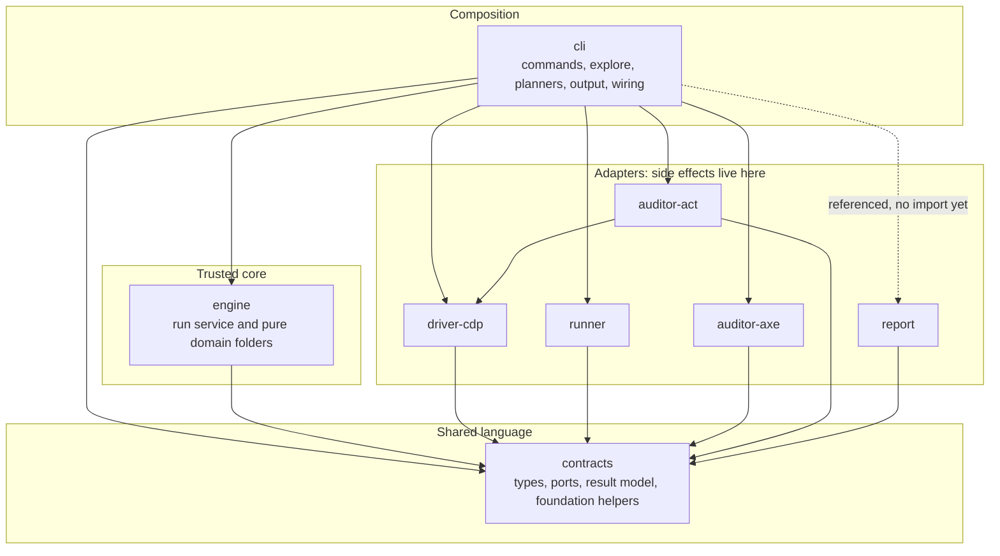
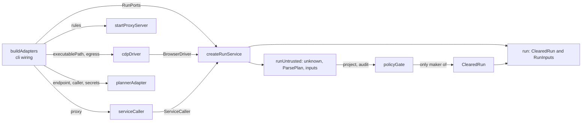
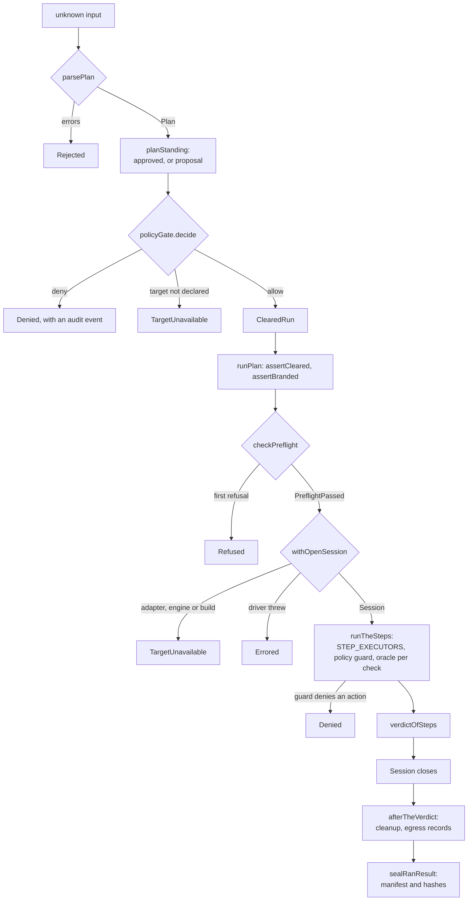
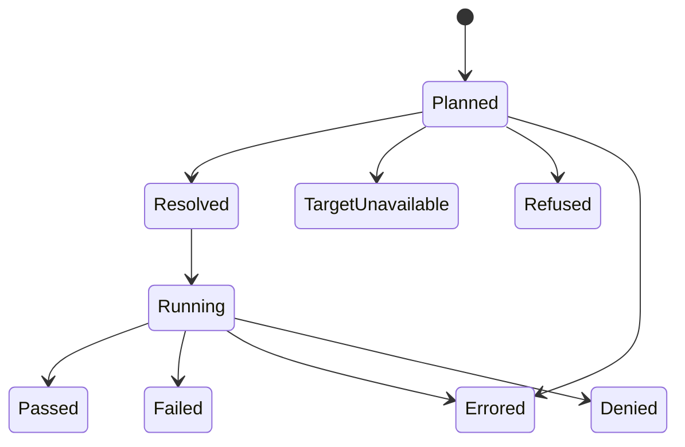
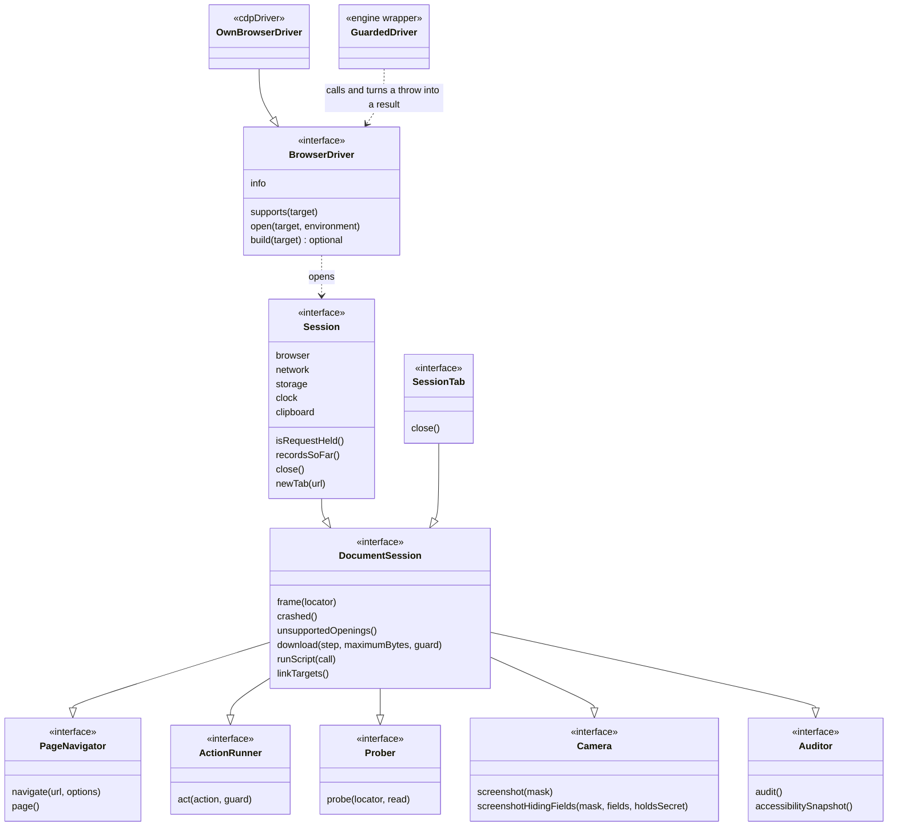

# Architecture: how the code fits together

## In short

- Eight npm workspaces in four layers. Every import points inwards, towards `contracts`, and `tsc` rejects a wrong-way one.
- `cli` is the only place parts are wired together, in `packages/cli/src/wiring/BuildAdapters.ts`.
- A run has one way in: `createRunService(ports)` in `packages/engine/src/run/RunService.ts`, and it runs only a `ClearedRun`, which only the policy gate makes.
- Everything a step needs is in tables keyed by step type, so a new step is a list of compile errors to clear, not a search.
- Adding a step takes 18 edits, most of them one line. After the first, `tsc` or a repository rule demands 16, and a unit test the last.

This document describes the code as it stands. The reasons and the differences from the plan are in `docs/decisions/architecture-refactor.md`.

## Decisions

| Decision | Why |
|---|---|
| Plain TypeScript: factories that take their dependencies, tables keyed by step type, no DI container or class hierarchy | A new developer can read it, and the compiler lists what a change touches |
| Trust rules live in repository rules (`tools/repo-rules/`), not ESLint | An ESLint suppression would be an opt-out |
| A `ClearedRun` is a class with a private field, and `runPlan` checks it again at run time | An object written by hand, a copy or a spread can't pass, whatever a cast says |
| A port a run was given nothing for is an `UnwiredPort`, not an optional member | Preflight can refuse a plan that needs it, before any side effect |
| A driver's promise of a `Result` is enforced by `packages/engine/src/target/GuardedDriver.ts` | A broken driver says nothing about the target, so the run ends `Errored`, not `TargetUnavailable` |
| A fresh browser per run in production; a shared browser only through the driver's `./testing` entry | Isolation between runs matters more than speed |

## Findings

### 1. Dependency layers

The compiler enforces the arrows between packages through each package's `references` in its `tsconfig.json`. `tools/repo-rules/code/CheckImports.ts` adds what `tsc` can't see: `contracts` and `engine` import only Node built-ins and, for `engine`, `contracts`, and neither declares a runtime dependency.

- `auditor-act` importing `driver-cdp` is the one exception, for the browser connection and launcher.
- Inside `engine`, only two rules are enforced. `tools/repo-rules/code/CheckImportCycles.ts` fails on any import cycle, and its `ONE_WAY_FOLDERS` keeps `packages/engine/src/project/` from importing `packages/engine/src/plan/`.
- The split between run service and pure domain is a convention, not a boundary: `packages/engine/src/policy/PolicyGate.ts` and `packages/engine/src/approval/PlanStanding.ts` both take `planHash` from `packages/engine/src/run/seal/BuildManifest.ts`.

### 2. Services and factories

| Pattern | Where | What it removes |
|---|---|---|
| Functional core | `packages/engine/src/plan/`, `policy/`, `secrets/`, `run/outcome/Verdict.ts` | Tests that need a browser |
| Ports and adapters | `packages/contracts/src/ports/`, implemented by the outer packages | The engine knowing about Chrome or Docker |
| Application service | `createRunService(ports)` | Hand-written trust, gate and run sequences |
| Factory with injection | `cdpDriver({ executablePath, egress, browserSource })` | No way to share a browser in tests |
| Composition root | `buildAdapters` in `packages/cli/src/wiring/BuildAdapters.ts`, kept the only one by `tools/repo-rules/code/CheckCompositionRoot.ts` | A browser opened without its egress proxy |
| Exhaustive tables | `{ readonly [Type in StepType]: … }`, see section 5 | Scattered lists and switches |

`tools/repo-rules/code/CheckCompositionRoot.ts` reads tokens, so it guards against mistakes, not deliberate evasion. The guarantee rests on the required `egress` option and the egress proofs in `test/proofs/egress/`.

### 3. The run pipeline

Each stage gives a typed value or stops with a typed reason. `packages/engine/src/run/RunUntrusted.ts` covers the stages up to the gate, and `packages/engine/src/run/RunPlan.ts` the rest.

- **Trust** doesn't stop a run. A plan with no approval of its own hash is a proposal, which the gate judges more strictly and which never reaches a production origin.
- **The policy gate** has two halves in `packages/engine/src/policy/PolicyGate.ts`: `decide` before the run, and `guardAction`, which the driver calls before every action.
- **Preflight** in `packages/engine/src/run/preflight/CheckPreflight.ts` refuses before any side effect, in a fixed order that results show: base URL off the project's origins, production origin, missing secret, missing script source, unwired services, saved storage state, an element check no driver decides, unwired database commands.
- **The oracle** in `packages/engine/src/run/outcome/Verdict.ts` is pure and is called by the check executors, once per check.
- **After the verdict**, what happens is in `packages/engine/src/run/after-the-verdict/`, and the seal in `packages/engine/src/run/seal/`.

The lifecycle is a type in `packages/engine/src/run/outcome/Transition.ts`, so an illegal transition doesn't compile:

### 4. The driver port

The port is in `packages/contracts/src/ports/BrowserDriver.ts`; `packages/driver-cdp/src/session/CdpDriver.ts` implements it. Every member is required except `build`, because a driver may be unable to pin its browser. Nothing in the port depends on what a step does: it takes only resolved types, with no value references left.

- `act` requires its guard. A driver resolves the element, asks the guard and acts only on an allow.
- `unsupported-step` stays for what it really means: popups, unclaimed downloads and leftover references.
- The same session contract, `test/support/session-contract/SessionContract.ts`, runs over the fake session and the real driver.
- The other ports are `Runner` and `WorkloadRunner`, `ArtifactStore`, `SecretStore` and `ApprovalStore`, all in `packages/contracts/src/ports/`. `Runner` is `withRun` alone, and the guarantee level is read from the run itself.

### 5. What a step is made of

| Concern | Table or switch | File |
|---|---|---|
| Name | `StepType` | `packages/contracts/src/plan/StepType.ts` |
| Shape | `Step`, with `StepByType` for tables | `packages/contracts/src/plan/Plan.ts` |
| Facts: section, fields, placement, whether it checks, changes the page or is unsafe | `STEP_FACTS` | `packages/engine/src/plan/StepFacts.ts` |
| Parsing | one `StepReaderTable` per section, joined in `STEP_READERS` | `packages/engine/src/plan/parse/steps/` |
| Readable plan text | `STEP_FORMS` | `packages/engine/src/plan/readable/StepStatements.ts` |
| Published schema | `STEP_FIELD_SCHEMAS`, `STEP_TYPE_FIELD_SCHEMAS` | `packages/engine/src/plan/schema/PlanJsonSchema.ts` |
| Secrets it names | one function per type | `packages/engine/src/plan/SecretsNamedBy.ts` |
| Policy | `STEP_RULES` | `packages/engine/src/policy/StepRules.ts` |
| Secret resolution | exhaustive switch in `runStepOf` | `packages/engine/src/secrets/ResolvePlanSecrets.ts` |
| Running | `STEP_EXECUTORS` | `packages/engine/src/run/executors/StepExecutors.ts` |
| Release notes | exhaustive switch | `packages/engine/src/evidence/WriteReleaseNotes.ts` |

`ASSERTION_STEP_TYPES` and the other step lists are derived from `STEP_FACTS`. `visitSteps` in `packages/engine/src/plan/VisitSteps.ts` is the one walker of nested steps.

### 6. Recipe: add a step

Start from a real neighbour. `expectClipboard` is the example: a check in the clock-and-clipboard section. Search for it to see every entry. Add the step to `StepType` and `Step`, then run `npm run check` and clear what it reports.

| # | File | Add | What makes you do it |
|---|---|---|---|
| 1 | `packages/contracts/src/plan/StepType.ts` | The constant | `tsc`, once the step's type uses it |
| 2 | `packages/contracts/src/plan/Plan.ts`, or a section file such as `packages/contracts/src/plan/steps/ClockAndClipboardStep.ts` | A member of the `Step` union | The starting edit |
| 3 | `packages/engine/src/plan/StepFacts.ts` | Its facts: section, fields, `changesPage`, `unsafeConstructs` | `tsc` |
| 4 | `packages/engine/src/plan/parse/steps/ClockAndClipboardStepReaders.ts`, or the file of the section you chose | A reader. Plan text goes through `readWrittenText`, so it reaches the secret scan | `tsc` |
| 5 | `packages/engine/src/plan/SecretsNamedBy.ts` | The secrets it names, or `none` | `tsc` |
| 6 | `packages/engine/src/plan/readable/StepStatements.ts` | Its readable form in `STEP_FORMS` | `tsc` |
| 7 | `packages/engine/src/plan/schema/PlanJsonSchema.ts` | A schema for any field that has none | Building the schema throws, so `npm run lint` fails |
| 8 | `packages/engine/src/policy/StepRules.ts` | Its rule in `STEP_RULES`, for example `readOnlyRules` | `tsc` |
| 9 | `packages/engine/src/secrets/ResolvePlanSecrets.ts` | A case in `runStepOf` | `tsc` |
| 10 | `packages/engine/src/evidence/WriteReleaseNotes.ts` | A case in the switch | `tsc` |
| 11 | A new file beside `packages/engine/src/run/executors/clock-and-clipboard/CheckClipboard.ts`, and its entry in `packages/engine/src/run/executors/clock-and-clipboard/ClockAndClipboardExecutors.ts` or `packages/engine/src/run/executors/StepExecutors.ts` | The executor, and its table entry | `tsc` |
| 12 | `docs/plan-language/plan.schema.json` | Regenerate: `node tools/repo-rules/docs/CheckPlanSchema.ts --write` | `npm run lint` |
| 13 | `docs/plan-language/CHANGELOG.md` | A new entry naming the sha256 that command prints | `npm run lint` |

The test set takes five more edits, in their own tests commit:

| # | File | Add | What makes you do it |
|---|---|---|---|
| 14 | `test/unit/engine/plan/parse/StepReadersKeepEveryField.test.ts` | A full step of the new type | `tsc` |
| 15 | `test/unit/engine/plan/examples/EveryStepTypeExamples.ts` | Its examples | `tsc` |
| 16 | `test/unit/engine/plan/readable/examples/ParsePlan.ts` | The type in `EVERY_STEP_TYPE` | `tsc` |
| 17 | `test/unit/engine/plan/readable/examples/ParsePlan.ts` | A plan example that uses the step | A unit test only |
| 18 | `test/unit/engine/drafting/PageChangingStepsInDraftChecks.test.ts` | Whether it changes the page | `tsc` |

A new section adds a value to `StepSection` in `packages/engine/src/plan/StepFacts.ts`, a readers file spread into `STEP_READERS` in `packages/engine/src/plan/parse/steps/ReadStep.ts`, and an executors folder spread into `STEP_EXECUTORS`.

A new error code also needs a heading in `docs/errors.md`, which `tools/repo-rules/docs/CheckErrorAnchors.ts` checks.

## Risks

- **The recipe wasn't re-run.** It comes from the throwaway step built before the phase 4 move (16 edits), mapped to today's paths, with the exhaustive tables added since found by reading.
- **One driver implements the port.** Nothing yet shows a second driver could; the guarantee that adapters are substitutable is withdrawn until one exists.
- **Layers inside `engine` are not enforced**, apart from the no-cycles rule and the one folder direction above.
- **The schema table is not compiler-forced.** A missing field schema fails only when the schema is built.
