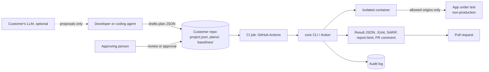
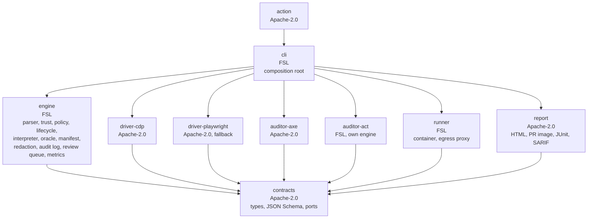
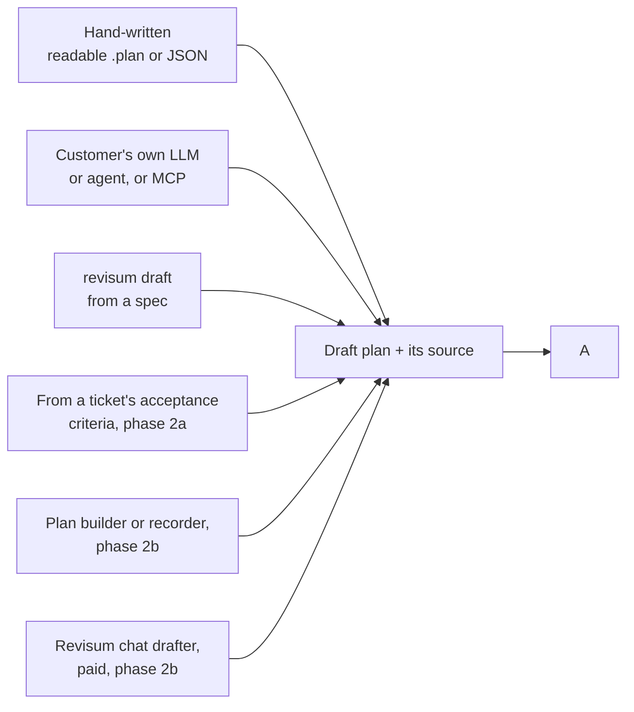
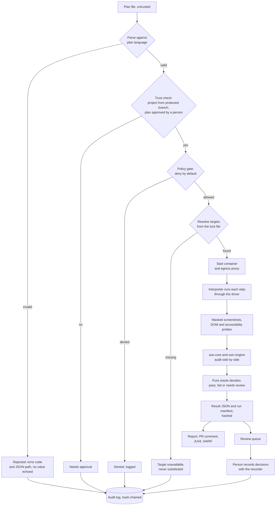

# System design: what is built, with what, and where it lives

- **Serves:** the founder's approval of `09`. It shows what phase 1 implements and how, in one place, before any product code exists.
- **As of:** 2026-10-27. It brings together `04` (architecture), `06` (stack), `11` (interface), `12` (drivers and engines) and the specs in `specs/`, and adds the package layout, folder structure and naming rules.
- **Terms:** *engine* means the trusted core library (the "core" of `04`). *Package* means one npm workspace in the product repo. *Revisum* is the product name (chosen 2026-10-27; UK and EU trademark checks pending); `revisum` is the repo, package and CLI name.
- **Research references:** two-digit doc numbers such as `04` or `09`, claim IDs `[C-…]` and `[calc:…]` markers point to the research repo `E:\core\docs` (read-only at `/research-docs` in the dev container). They are background, never names in code.

## In short

- **One TypeScript monorepo on Node 24 with ten phase-1 packages.** A zero-dependency engine sits in the middle. Drivers, auditors, renderers, the runner and the CLI plug into it through typed ports. The compiler rejects any import in the wrong direction.
- **One run is a straight pipeline:** parse the plan, then check trust and policy, resolve targets, run in an isolated container, capture masked evidence, audit accessibility with two engines, and decide with a pure oracle. The run ends by writing a hashed result, report, PR comment and review queue.
- **AI never reaches execution unparsed.** Plans arrive as `unknown` and become typed only through the engine's parser. Every human decision goes into a hash-chained audit log.
- **The code must read without the research.** No research IDs appear in any identifier, names are domain words, and a CI lint enforces both (Finding 6).
- **Start here, then `15`.** `15` turns this design into the first sessions, prompts and repository settings.

## Decisions

| Decision | Why (evidence) | Confidence (high/med/low) |
|---|---|---|
| TypeScript on Node 24 LTS, erasable syntax only, `tsc` as a required gate | Node strips types but checks nothing [C-R10-001][C-R10-002]; the P3 core ran this way with 0 [spike:p3_core_runtime_deps] runtime dependencies (`06`) | high |
| One repo, npm workspaces, one package per port family; TypeScript project references make wrong-way imports a compile error | `04` Finding 5 and `06` Finding 1 ask for compiler-enforced direction; SPEC-00 AC-02 | high |
| Public contracts live in an Apache-2.0 `contracts` package; the engine, runner, own accessibility engine and CLI are FSL-1.1 | Adapters must not depend on FSL code; the layer split follows `07` Finding 3; where the CLI and Action fall is a design call | med |
| Own CDP driver on Chromium; the Playwright adapter stays the fallback until the capability tests pass | Own drivers passed 32 [spike:p4_contract_passed] of 32 contract tests with 0 [spike:p4_adapter_runtime_deps] runtime dependencies; iframes, dialogs, uploads and crash recovery are unbuilt (`12`) | med |
| axe-core 4.14.0 and core's own ACT engine run side by side; axe is the reference the own engine is measured against | axe covers 8 [calc:f2_a11y_sc_axe_only] criteria the own engine doesn't (`12`); founder decision, 2026-10-27 | high |
| Runs execute in a container pinned by digest, with an egress proxy outside the browser; the same image is the dev container | Container digests pin OS and fonts [C-R13-004]; in-browser routing leaks [C-F1-005]; one image keeps local and CI runs equal | med |
| Tests, proofs, fixtures and golden files live in top-level folders that code owners hold, apart from the code | Models edit tests to pass [C-R13-062]; SPEC-00 AC-05 | high |
| No product names, research IDs or single letters in code identifiers; a lint enforces it | Founder requirement, 2026-10-27: maintainable by people without AI | high |

## Findings

### 1. Tech stack

**Everything is TypeScript on Node with built-in modules; third-party code is limited to what passes the dependency review.**

| Layer | Choice | Notes |
|---|---|---|
| Runtime | Node 24 LTS | Built-in `fetch`, `WebSocket`, `node:crypto`, `node:test` |
| Language | TypeScript, erasable syntax only; strict mode | `tsc --noEmit` is a required check; TypeScript 7 when stable [C-R10-004] |
| Workspace | npm workspaces, project references | No build step for the engine; packages publish compiled JS and `.d.ts` |
| Validation | Hand-written decoders in the engine | No Zod in the trust path; 29 [spike:p3_hostile_rejected] of 29 hostile plans rejected (P3) |
| Public schema | JSON Schema 2020-12, generated from the TypeScript types | Agents draft plans against it |
| Browser | Chrome for Testing and chrome-headless-shell, pinned by version and executable hash | Headless shell in CI [C-R10-016] |
| Accessibility | axe-core 4.14.0 (MPL-2.0, files unmodified) and core's own ACT-rule engine | Run side by side on Chromium |
| Isolation | Docker image pinned by digest; an egress proxy allows only declared origins | The same image runs CI and the dev container |
| Outputs | JSON result, JUnit XML, SARIF, HTML report, PR image and comment | GitHub reads SARIF; other CIs read JUnit [C-R07-027][C-R07-025] |
| Audit | Append-only JSONL, hash-chained, anchored outside the agent's write scope | Actors pseudonymous |
| CI | GitHub Actions on a pinned Linux image; short-lived OIDC tokens | [C-R09-022] |
| Tests | `node:test`; one contract suite per port; proofs; golden replays | No retries |

**Action:** pin every version above in the M0 seed; any new third-party package needs a dependency review (SPEC-00).

### 2. System context: who and what core touches

**Core runs on the customer's machine or CI; nothing in phase 1 is hosted.**



- Secrets are references resolved inside the job; they never enter plans or artefacts (SPEC-04).
- The hosted history module comes later (`07`) and only receives redacted artefacts.

### 3. Packages and how they depend on each other

**Every arrow points towards `contracts`; the engine imports no adapter, and the CLI is the only place where parts are wired together.**



| Package | Job | Seeded from | Spec |
|---|---|---|---|
| `contracts` | Shared types, plan and result schemas, port interfaces | P7 core types, P3 `ports.ts` | SPEC-27, SPEC-01 |
| `engine` | Everything trusted: parse (readable and JSON plans), trust, policy, lifecycle, interpret, decide, hash, redact, record | P3 `src/core` | SPEC-01 to 05, 08, 11, 13 to 15, 28 |
| `driver-cdp` | Drive Chromium over CDP | P4 `src/drivers/cdp` and `shared` | SPEC-06 |
| `driver-playwright` | Fallback Chromium driver | P3 `src/adapters/playwright` | SPEC-06 |
| `auditor-axe` | Run axe-core in the page | P3 `src/adapters/shared/axe.ts` | SPEC-10 |
| `auditor-act` | Core's own ACT-rule engine | P5 `src` | SPEC-10 |
| `runner` | Start the pinned container and egress proxy | New | SPEC-07 |
| `report` | Report, PR image and exporters | P6 `src/render`, `src/model` | SPEC-11, SPEC-12 |
| `cli` | Commands `validate`, `lock`, `run`, `draft`, `export`, `review`, `approve`, `doctor` | P6 `cli.ts` (shape only) | SPEC-16, SPEC-28 |
| `action` | GitHub Action wrapper | New | SPEC-16 |

Phase 2 adds `driver-bidi` (Firefox, from P4), `mcp-server`, `tracker-github` and protocol packs under `packs/` (from P7).

**Action:** create exactly these packages at M0; a new package needs a spec that names its port.

### 4. One run, step by step

**Each stage either returns a typed value or stops the run with a typed reason; no stage can be skipped.**

Plans arrive by whatever route fits the team's workflow. Every route produces a draft that meets the same parser, gate and approval (SPEC-28):





- **Lifecycle states** follow `04` Finding 4: Proposed, Rejected, Planned, Denied, TargetUnavailable, Authorised, Resolved, Running, Passed, Failed, Errored. Illegal transitions are compile errors.
- **Approval routes** (SPEC-02, `13` FR-06). No gate sits behind a second person (founder, 2026-10-27):
  - **Declared:** the owner's approval under the agent lock-down in `15`. The coding agent can't commit, push or merge, so a merge to the protected branch is the founder's. It suffices for every subject: plans, trusted files, review decisions, high-risk extra reviews and holdout plans. Anything built on it is labelled `declared`.
  - **Verified (optional):** a code owner's review from an account other than the author's, for teams that have one. No feature, level or metric requires it.
  - An agent's own approval never gates.
- **Replay** re-runs a plan from its manifest and compares result hashes (SPEC-08).
- **AI's only role** is to propose plans and suggestions as data. Parsing, the gates and the oracle are deterministic (`04` Finding 3).

**Action:** build the stages in this order; each gets its contract tests before its code (`09` Finding 4).

### 5. Product repo folder structure

**Code, tests and trusted configuration sit in separate top-level folders, so ownership and the "tests apart" check are simple path rules.**

```
revisum/
├─ README.md               what it is, quick start, the "never more restrictive" licence promise
├─ CLAUDE.md               rules for coding agents (template in docs/build/)
├─ CONTRIBUTING.md         spec template, Definition of Done, session workflow
├─ LICENSE-APACHE  LICENSE-FSL  licences.json   per-package licence map, checked in CI
├─ package.json            npm workspaces and scripts: check, test, lint, proofs, replay
├─ tsconfig.base.json      strict, erasable syntax only, project references
├─ .devcontainer/          the pinned image used by CI; no GitHub credentials inside
├─ .claude/settings.json   agent deny rules: no commit, push, merge or PR approval
├─ .github/
│  ├─ workflows/ci.yml     tsc, lint, naming lint, contract, proofs, replay, a11y re-score, tests-apart
│  └─ CODEOWNERS           test/, proofs/, fixtures/, golden/, .github/ owned by the founder
├─ docs/
│  ├─ system-design.md     this doc, without research IDs
│  ├─ glossary.md          domain term → code name
│  ├─ decisions/           one short record per design decision
│  └─ specs/               SPEC-00 … SPEC-27
├─ packages/
│  ├─ contracts/   engine/   driver-cdp/   driver-playwright/
│  ├─ auditor-axe/ auditor-act/  runner/   report/   cli/   action/
│  │   each: src/, package.json, tsconfig.json, README.md
├─ test/
│  ├─ contract/            one suite every driver and auditor must pass unchanged
│  ├─ wcag/                data-driven WCAG 2.2 test base: one runner over every criterion (SPEC-29)
│  ├─ unit/<package>/      tests written from the spec's acceptance criteria
│  └─ proofs/              hostile plans, secret leaks, egress, PII, audit chain, manifest sufficiency
├─ fixtures/               small test sites and ACT cases
├─ golden/                 recorded runs and reports replayed in CI
└─ tools/                  naming lint, trace index, guarantee table and logging manifest generators
```

- Inside a package, folders are named after what they hold: `src/plan/`, `src/policy/`, `src/audit-log/`, never `src/p3/` or `src/r11/`.
- One concept per file, named after its main export: `policy-gate.ts` exports `evaluatePolicy`.

**Action:** SPEC-00 creates this tree; CI fails if a source file sits outside `packages/*/src` or a test sits outside `test/`.

### 6. Naming and readability rules

**The code must make sense to a developer who has never seen the research, so names carry meaning and IDs stay in data.**

| Rule | Example: no | Example: yes |
|---|---|---|
| No research or process IDs in identifiers, files, folders, packages, JSON keys, error codes or flags (R1–R13, RC, FR, NFR, UP, SC, FD, H, P1–P7, job or claim IDs, doc numbers) | `R11Test`, `checkFr06`, `p4Driver` | `DependencyCheck`, `rejectSelfApproval`, `CdpDriver` |
| Domain words, no single letters (except loop indices and x/y), no unexplained abbreviations | `T`, `V`, `acId`, `w` | `tracedCriteriaShare`, `verifiedWithoutReviewShare`, `criterionId`, `width` |
| Comments explain what and why in plain English; a spec path may be added, never instead | `// see 04 Finding 1` | `// Deny by default: an unknown action could be destructive. See docs/specs/SPEC-03.` |
| Traceability is data: criterion IDs appear only as test metadata, commit trailers and the trace index | `function ac_spec_01_03()` | `test('rejects unknown steps', { criterion: 'AC-SPEC-01-03' }, …)` |
| The product name appears once, in the `PRODUCT` constant | `'core-plan/v1'` scattered | `` `${PRODUCT.schemaNamespace}-plan/v1` `` |

Allowed abbreviations: id, url, uri, html, css, json, http, api, cli, ci, pr, cdp, bidi, wcag, act, a11y, pii, sha256, svg, png, dom, os. Standard names, each spelled out in the glossary: ai, mcp, sarif, junit, oidc, jwt, lti.

| Research term | Code name |
|---|---|
| T, F, V | `tracedCriteriaShare`, `flakyRunRate`, `verifiedWithoutReviewShare` |
| A, S, M | `agentAuthoredShare`, `specLinkedShare`, `mutantsCaughtShare` |
| P, U, E | `planApprovalsPerChange`, `unreviewedMergeShare`, `escapedDefects` |
| R11 keep/drop test | `DependencyReview` with `DependencyCheck` items |
| AC | `criterion` (`criterionId`, `criteriaInScope`) |
| Change class | `changeClass` (`changeClassId`) |

**Action:** ship the naming lint at M0 (SPEC-00) and `docs/glossary.md` with these rows. The lint fails on banned patterns, on single-letter exports and on research citations in comments.

### 7. What is built when

**The milestones in `09` map onto packages, so each one leaves a working, tested slice.**

| Milestone | Packages touched | Working slice at the exit |
|---|---|---|
| M0 seed | All skeletons; `engine`, `driver-cdp`, `auditor-act`, `report` from spikes | Spike suites pass unchanged in CI |
| M1 language and trust | `contracts`, `engine` | Plans in readable or JSON form parse, gate and need a person's approval |
| M2 driver and isolation | `driver-cdp`, `runner`, `engine` (manifest) | A plan runs in the container, egress blocked, replay matches. **Alpha** |
| M3 evidence | `auditor-axe`, `auditor-act`, `report`, `engine` (review, audit log, metrics); WCAG test base in `test/wcag/` and `fixtures/wcag/` | Report, PR comment, review queue and recorder work end to end; CI publishes "verifies N of M criteria" per level |
| M4 launch | `cli` (including `draft`), `action`, docs | `npx revisum run` and the Action work on a demo app. **Beta** |

**Action:** review this table against `09` at every milestone exit.

## Risks and open questions

- **The name needs UK and EU trademark checks.** Revisum cleared GitHub, npm, domains and US marks only; the `PRODUCT` constant keeps any rename to one line.
- **Licence boundaries need a lawyer's read.** Placing the CLI under FSL and the Action under Apache-2.0 is a design call, not evidence.
- **The dev container depends on Docker** on the founder's machine and in CI; egress enforcement in standard CI containers is unproven until M2 (`09` kill criteria).
- **The diagrams describe phase 1 only.** Firefox, MCP, packs and hosting change `cli` wiring but not the engine's ports.

## Sources

Full source list: `E:/core/docs/research/references.md`, section 14-system-design (the research repo; read-only at `/research-docs/research/references.md` in the dev container).
