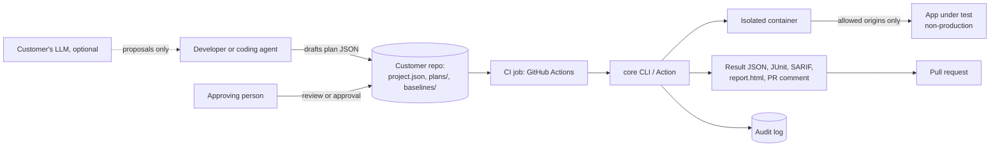
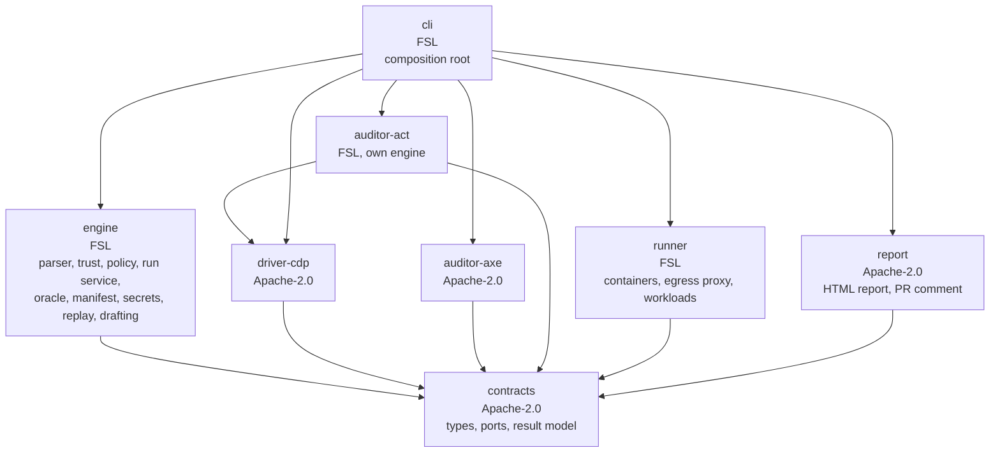
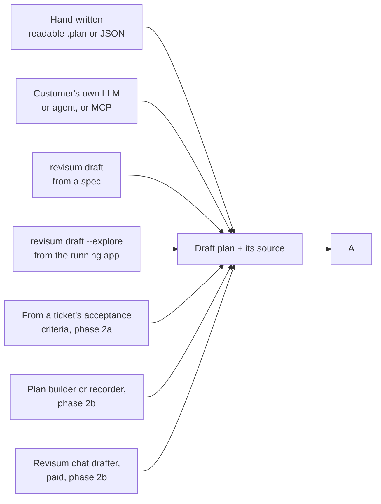
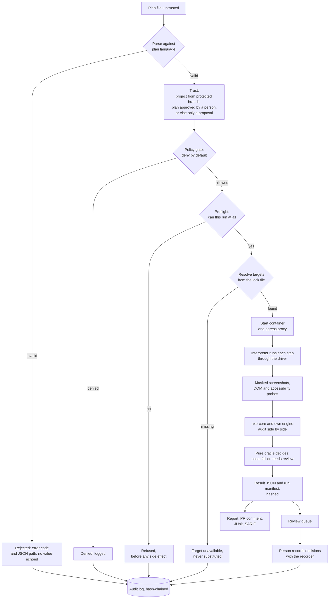
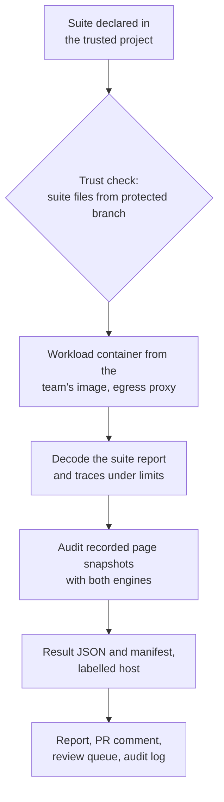

# System design: what is built, with what, and where it lives

- **Serves:** the founder's approval of `09`. It shows what phase 1 implements and how, in one place, before any product code exists.
- **As of:** 2026-10-27, with the packages, folders, naming and run stages brought in line with the code on 2026-11-09, after the architecture refactor (`docs/decisions/architecture-refactor.md`). It brings together `04` (architecture), `06` (stack), `11` (interface), `12` (drivers and engines) and the specs in `specs/`, and adds the package layout, folder structure and naming rules.
- **Terms:** *engine* means the trusted core library (the "core" of `04`). *Package* means one npm workspace in the product repo. *Revisum* is the product name (chosen 2026-10-27; UK and EU trademark checks pending); `revisum` is the repo, package and CLI name.
- **Research references:** two-digit doc numbers such as `04` or `09`, claim IDs `[C-…]` and `[calc:…]` markers point to the research repo `E:\core\docs`. They are background, never names in code.

## In short

- **One TypeScript monorepo on Node 24 with eight phase-1 packages (changed by the founder, 2026-11-02: `driver-playwright` and the stub `action` were removed; SPEC-16 recreates `action`).** A zero-dependency engine sits in the middle. Drivers, auditors, renderers, the runner and the CLI plug into it through typed ports. The compiler rejects any import in the wrong direction.
- **One run is a straight pipeline:** parse the plan, then check trust and policy, make the preflight checks, resolve targets, run in an isolated container, capture masked evidence, audit accessibility with two engines, and decide with a pure oracle. The run ends by writing a hashed result, report, PR comment and review queue.
- **AI never reaches execution unparsed.** Plans arrive as `unknown` and become typed only through the engine's parser. Every human decision goes into a hash-chained audit log.
- **The closed plan language is the default.** Evidence mode (a team's own Playwright suite, wrapped with Revisum's evidence) and unsafe plan features are opt-in in the trusted project file, and every output resting on them is labelled `host` (`docs/decisions/language-fit-pivot.md`).
- **The code must read without the research.** No research IDs appear in any identifier, names are domain words, and a CI lint enforces both (Finding 6).
- **Start here, then `15`.** `15` turns this design into the first sessions, prompts and repository settings.

## Decisions

| Decision | Why (evidence) | Confidence (high/med/low) |
|---|---|---|
| TypeScript on Node 24 LTS, erasable syntax only, `tsc` as a required gate | Node strips types but checks nothing [C-R10-001][C-R10-002]; the P3 core ran this way with 0 [spike:p3_core_runtime_deps] runtime dependencies (`06`) | high |
| One repo, npm workspaces, one package per port family; TypeScript project references make wrong-way imports a compile error | `04` Finding 5 and `06` Finding 1 ask for compiler-enforced direction; SPEC-00 AC-02 | high |
| Public contracts live in an Apache-2.0 `contracts` package; the engine, runner, own accessibility engine and CLI are FSL-1.1 | Adapters must not depend on FSL code; the layer split follows `07` Finding 3; where the CLI and Action fall is a design call | med |
| Own CDP driver on Chromium, the only driver in phase 1 (changed by the founder, 2026-11-02: the Playwright fallback adapter was removed; Firefox comes through BiDi in SPEC-19) | Own drivers passed 32 [spike:p4_contract_passed] of 32 contract tests with 0 [spike:p4_adapter_runtime_deps] runtime dependencies (`12`); iframes, dialogs, uploads and crash recovery have since been built | med |
| axe-core 4.14.0 and core's own ACT engine run side by side; axe is the reference the own engine is measured against | axe covers 8 [calc:f2_a11y_sc_axe_only] criteria the own engine doesn't (`12`); founder decision, 2026-10-27 | high |
| Runs execute in a container pinned by digest, with an egress proxy outside the browser; the same image is the dev container | Container digests pin OS and fonts [C-R13-004]; in-browser routing leaks [C-F1-005]; one image keeps local and CI runs equal | med |
| Tests, proofs, fixtures and golden files live under one top-level `test/` folder that the founder owns, apart from the code | Models edit tests to pass [C-R13-062]; SPEC-00 AC-05 | high |
| No product names, research IDs or single letters in code identifiers; a lint enforces it | Founder requirement, 2026-10-27: maintainable by people without AI | high |
| The closed language stays the default; evidence mode and unsafe features are enabled only in the trusted project file, labelled `host` and never counted as verified evidence | The coverage study found 36% of fresh intents expressible against the 70% language-fit criterion; founder decision, 2026-10-28 (`docs/decisions/language-fit-pivot.md`) | high |

## Findings

### 1. Tech stack

**Everything is TypeScript on Node with built-in modules; third-party code is limited to what passes the dependency review.**

| Layer | Choice | Notes |
|---|---|---|
| Runtime | Node 24 LTS | Built-in `fetch`, `WebSocket`, `node:crypto`, `node:test` |
| Language | TypeScript, erasable syntax only; strict mode | `tsc --noEmit` is a required check; TypeScript 7 when stable [C-R10-004] |
| Workspace | npm workspaces, project references | No build step for the engine; packages publish compiled JS and `.d.ts` |
| Validation | Hand-written decoders in the engine | No Zod in the trust path; 29 [spike:p3_hostile_rejected] of 29 hostile plans rejected (P3) |
| Public schema | JSON Schema 2020-12, built by the engine from its step tables | Agents draft plans against it |
| Browser | Chrome for Testing and chrome-headless-shell, pinned by version and executable hash | Chrome for Testing on every push; the headless-shell target in the weekly full tier |
| Accessibility | axe-core 4.14.0 (MPL-2.0, files unmodified) and core's own ACT-rule engine | Run side by side on Chromium |
| Isolation | Docker image pinned by digest; an egress proxy allows only declared origins. Evidence suites and database commands run in the team's own workload images, also pinned by digest | The same image runs CI and the dev container |
| Outputs | JSON result, JUnit XML, SARIF, HTML report, PR image and comment | GitHub reads SARIF; other CIs read JUnit [C-R07-027][C-R07-025] |
| Audit | Append-only JSONL, hash-chained, anchored outside the agent's write scope | Actors pseudonymous |
| CI | GitHub Actions on a pinned Linux image; short-lived OIDC tokens | [C-R09-022] |
| Tests | `node:test`; one session contract run over the fake and the real driver; proofs; golden replays | No retries |

**Action:** pin every version above in the M0 seed; any new third-party package needs a dependency review (SPEC-00).

### 2. System context: who and what core touches

**Core runs on the customer's machine or CI; nothing in phase 1 is hosted.**



- Secrets are references resolved inside the job; they never enter plans or artefacts (SPEC-04).
- The hosted history module comes later (`07`) and only receives redacted artefacts.

### 3. Packages and how they depend on each other

**Every arrow points towards `contracts`; the engine imports no adapter, and the CLI is the only place where parts are wired together.** One exception: `auditor-act` reuses `driver-cdp`'s browser connection and launcher rather than keeping a second copy (founder decision, 2026-10-28). The diagrams of the layers, services, run pipeline and driver port are in `docs/architecture.md`.



| Package | Job, as built | Spec |
|---|---|---|
| `contracts` | Shared types, port interfaces, the result model, constant objects and small foundation helpers. The JSON Schema is built in `engine` | SPEC-27, SPEC-01 |
| `engine` | Everything trusted: parse (readable and JSON plans), project, approval, policy, secrets, the run service, oracle, manifest, replay, drafting; decode suite reports and traces. M3 adds the audit log, review queue and metrics | SPEC-01 to 05, 08, 11, 13 to 15, 28, 35, 36 |
| `driver-cdp` | Drive Chromium over CDP. A test-only entry, `./testing`, holds the launchers production must not reach | SPEC-06 |
| `auditor-axe` | Run axe-core in the page | SPEC-10 |
| `auditor-act` | Core's own ACT-rule engine | SPEC-10 |
| `runner` | Start the pinned container and egress proxy; the workload runner starts team images by digest; the service caller goes through the proxy | SPEC-07, SPEC-35 |
| `report` | The HTML report and PR comment, with their model. The other exporters are still to come | SPEC-11, SPEC-12 |
| `cli` | The composition root, `packages/cli/src/wiring/BuildAdapters.ts`, and the `draft` (with explore) and suite-run commands. It has no `bin` yet; SPEC-16 adds the rest of the commands | SPEC-16, SPEC-28 |

- `cli` references `report` in its `tsconfig.json` but doesn't import it yet.
- `contracts` and `engine` import only Node built-ins and, for `engine`, `contracts`: `tools/repo-rules/code/CheckImports.ts` enforces it and `tsc` rejects a wrong-way import between packages.

Evidence mode and unsafe features add no package (SPEC-35, SPEC-36). SPEC-16 creates the `action` package (the GitHub Action wrapper). Phase 2 adds `driver-bidi` (Firefox), `mcp-server`, `tracker-github` and protocol packs.

**Action:** a new package needs a spec that names its port.

### 4. One run, step by step

**Each stage either returns a typed value or stops the run with a typed reason; no stage can be skipped.**

Plans arrive by whatever route fits the team's workflow. Every route produces a draft that meets the same parser, gate and approval (SPEC-28):





Evidence mode is a second entry route (SPEC-35). It runs a team's own Playwright suite instead of a plan, then joins the same result stages:



- **Unsafe features** (SPEC-36): the parse stage accepts CSS and XPath locators, DOM checks, page scripts and database commands only when the trusted project enables them; otherwise the plan is rejected.
- **Who may run:** a run takes only a `ClearedRun`, made only by the policy gate for one plan, project, target and standing. A plan with no approval of its own hash is a proposal: the gate judges it more strictly and it never reaches a production origin.
- **Lifecycle states** are in `packages/engine/src/run/outcome/Transition.ts`: Planned, Resolved, Running, then Passed, Failed, Errored, Denied, TargetUnavailable or Refused. Illegal transitions are compile errors. A plan the parser rejects never gets a state of the run; it ends as Rejected.
- **Approval routes** (SPEC-02, `13` FR-06). No gate sits behind a second person (founder, 2026-10-27):
  - **Declared:** the owner's approval under the agent lock-down in `15`. The coding agent may commit but can't push or merge, so a push or merge to the default branch is the founder's (`docs/decisions/single-session-workflow.md`). It suffices for every subject: plans, trusted files, review decisions, high-risk extra reviews and holdout plans. Anything built on it is labelled `declared`.
  - **Verified (optional):** a code owner's review from an account other than the author's, for teams that have one. No feature, level or metric requires it.
  - An agent's own approval never gates.
- **Replay** re-runs a plan from its manifest and compares result hashes (SPEC-08). The result hash leaves out `blockedOrigins`, which a request sent as a run ends can change; the evidence hash covers them. Both are unkeyed, so an edit to a result shows only against a copy of the hash held elsewhere.
- **AI's only role** is to propose plans and suggestions as data. Parsing, the gates and the oracle are deterministic (`04` Finding 3).

**Action:** build the stages in this order; each gets its contract tests before its code (`09` Finding 4).

### 5. Product repo folder structure

**Code, tests and trusted configuration sit in separate top-level folders, so ownership and the "tests apart" check are simple path rules.**

```
revisum/
├─ README.md  CLAUDE.md  CONTRIBUTING.md  START.md
├─ LICENSE-APACHE  LICENSE-FSL  licences.json   per-package licence map, checked in CI
├─ package.json            npm workspaces and scripts
├─ tsconfig.json  tsconfig.base.json            strict, erasable syntax only, project references
├─ .prettierrc.json  .editorconfig  eslint-suppressions.json
├─ .devcontainer/          the pinned image used by CI and `npm run check:linux`
├─ .claude/                settings.json (agent deny rules) and rules/ (conventions by path)
├─ .github/
│  ├─ workflows/           ci.yml, full-tier.yml, benchmark.yml, browser-upkeep.yml
│  └─ CODEOWNERS           test/ and .github/ owned by the founder
├─ docs/
│  ├─ system-design.md  architecture.md  glossary.md  guarantees.md  errors.md  build-loop.md
│  ├─ decisions/           one short record per design decision
│  ├─ plan-language/       the published plan schema and its changelog
│  ├─ coverage-study/      the record of the language-fit question
│  ├─ prompts/             briefs for helper sessions
│  └─ specs/               one spec per unit of work
├─ packages/
│  ├─ contracts/src/       foundation/ plan/ ports/ run-result/ events/ errors/ modes/ product/
│  ├─ engine/src/          plan/ project/ approval/ policy/ secrets/ target/ run/ replay/
│  │                       evidence/ drafting/ decoding/ foundation/
│  ├─ driver-cdp/src/      connection/ launch/ page/ session/ in-page/ capabilities/ testing/
│  ├─ runner/src/          containers/ egress/ egress-proxy/ workload/ service-calls/ image/
│  ├─ auditor-act/src/     scan/ page/ rules/ in-page/
│  ├─ auditor-axe/src/     audit/
│  ├─ report/src/          model/ render/
│  └─ cli/src/             commands/ explore/ planners/ output/ wiring/
├─ test/
│  ├─ unit/<package>/<feature>/   tests of one package, by public API; test data in examples/
│  ├─ browser/<capability>/       real Chromium
│  ├─ proofs/<guarantee>/         hostile plans, secrets, egress, repository rules
│  ├─ containers/  replay/  support/
│  └─ fixtures/  golden/          test sites, plans and recorded runs
└─ tools/                  repo-rules/ test-runner/ metrics/ browsers/ scheduled/ eslint/
```

- Each package also has `package.json`, `tsconfig.json`, `README.md` and `src/index.ts`, which holds what other packages may use.
- `packages/engine/src/run/` holds the run service and preflight/, session/, steps/, executors/, outcome/, after-the-verdict/, seal/, logging/ and values/. `packages/engine/src/run/executors/` has one folder per step section.
- `packages/engine/src/plan/` holds `StepFacts.ts`, and parse/, readable/ and schema/. M3 adds folders for the review queue, audit log and metrics as their specs need them.
- `packages/driver-cdp/src/` holds `connection/` (the CDP socket, commands and event decoders), `launch/` (starting and stopping Chromium), `page/` (one page's commands, reads and input), `in-page/` (functions that run in the page), `session/` (the session's ports) and `capabilities/` (downloads, egress, network stubs, clock, clipboard, storage, audit rules).
- A package has no loose files beside `src/index.ts`, and no folder has more than 12 code files directly in it. Both hold today but no tool checks them.
- Customer repositories may hold `plans/scripts/`, the page scripts their project declares (SPEC-36). Like everything under `plans/`, they are trusted files.

**Action:** `tools/repo-rules/CheckLayout.ts` fails if a source file sits outside `packages/*/src` or `tools/`, a test sits outside `test/`, or a package lacks one of its four required files.

### 6. Naming and readability rules

**The code must make sense to a developer who has never seen the research, so names carry meaning and IDs stay in data.** `.claude/rules/typescript.md` holds the rules no tool can check, and `docs/decisions/code-conventions.md` says why.

| Rule | Example: no | Example: yes |
|---|---|---|
| No research or process IDs in identifiers, files, folders, packages, JSON keys, error codes or flags (R1–R13, RC, FR, NFR, UP, SC, FD, H, P1–P7, job or claim IDs, doc numbers) | `R11Test`, `checkFr06`, `p4Driver` | `DependencyCheck`, `rejectSelfApproval`, `CdpDriver` |
| Domain words, no single letters (except loop indices and x/y), no unexplained abbreviations | `T`, `V`, `acId`, `w` | `tracedCriteriaShare`, `verifiedWithoutReviewShare`, `criterionId`, `width` |
| A file is named in PascalCase after its main export; folders are kebab-case; `index.ts` stays lowercase | `policy-gate.ts`, `utils.ts` | `PolicyGate.ts`, `run-result/` |
| A fixed set of values is a constant object with a type of the same name, because real enums can't run under Node's type stripping | `kind === "textEquals"` | `kind === ClipboardAssertionKind.TextEquals` |
| `function` for named declarations and anything relying on `this`; method shorthand on objects; arrows for callbacks and functions assigned to a declared type | `export const run = function () { … }` | `export function createRunService(…)` |
| Comments say why in plain English and never cite a spec | `// see 04 Finding 1` | `// Deny by default: an unknown action could be destructive.` |
| Traceability lives in the `Spec:` and `Criteria:` commit trailers: spec and criterion IDs never appear in code, tests or comments | A spec ID in a function name or comment | The ID in the commit message's trailer |
| The product name appears once, in the `PRODUCT` constant | `'core-plan/v1'` scattered | `` `${PRODUCT.schemaNamespace}-plan/v1` `` |

Allowed abbreviations: id, url, uri, html, css, json, http, api, cli, ci, pr, cdp, bidi, wcag, act, a11y, pii, sha256, svg, png, dom, os. Standard names, each spelled out in the glossary: ai, mcp, sarif, junit, oidc, jwt, lti.

A customer's own `criterionId` in a plan is product data, not a name, and stays.

| Research term | Code name |
|---|---|
| T, F, V | `tracedCriteriaShare`, `flakyRunRate`, `verifiedWithoutReviewShare` |
| A, S, M | `agentAuthoredShare`, `specLinkedShare`, `mutantsCaughtShare` |
| P, U, E | `planApprovalsPerChange`, `unreviewedMergeShare`, `escapedDefects` |
| R11 keep/drop test | `DependencyReview` with `DependencyCheck` items |
| AC | `criterion` (`criterionId`, `criteriaInScope`) |
| Change class | `changeClass` (`changeClassId`) |

**Action:** `npm run lint:names` and ESLint (`npm run lint:code`) enforce these, with `revisum/file-name-matches-export` for file names. Magic strings still baselined in `eslint-suppressions.json` go in phase 6.

### 7. What is built when

**The milestones in `09` map onto packages, so each one leaves a working, tested slice.**

| Milestone | Packages touched | Working slice at the exit |
|---|---|---|
| M0 seed | All skeletons; `engine`, `driver-cdp`, `auditor-act`, `report` from spikes | Spike suites pass unchanged in CI |
| M1 language and trust | `contracts`, `engine` | Plans in readable or JSON form parse, gate and need a person's approval. SPEC-35's suite declaration, suite-file trust, report decoder, result mapping and labels (no containers), and SPEC-36's plan 1.3 parser parts, declarations, gate rules and labels; coverage measured on 1.3 with parsed plans (built) |
| M2 driver and isolation | `driver-cdp`, `runner`, `engine` (manifest) | A plan runs in the container, egress blocked, replay matches. SPEC-35's workload runner runs a suite with egress, traces and manifest, before the remaining plan-language driver parts; SPEC-36's driver parts (CSS, XPath, DOM checks, page scripts), then database commands. `cli`: SPEC-28's `draft` and SPEC-37's `draft --explore` (moved from M4, 2026-10-29). **Alpha** |
| M3 evidence | `auditor-axe`, `auditor-act`, `report`, `engine` (review, audit log, metrics); WCAG test base in `test/wcag/` and `fixtures/wcag/` | Report, PR comment, review queue and recorder work end to end; CI publishes "verifies N of M criteria" per level. SPEC-35's snapshot audit, masked captures, report, PR comment and review queue; SPEC-36's labels in exporters |
| M4 launch | `cli` (the remaining commands), `action`, docs | `npx revisum run` and the Action work on a demo app. SPEC-35's `run --suite` and Action input; SPEC-36's `doctor` checks and claim-lint wording. **Beta** |

The slices above are unchanged. The order in which they are built puts a demo first (founder, 2026-11-10): M3 up to SPEC-35's part, then a demo part of SPEC-16 ahead of SPEC-29 and SPEC-15 (`docs/decisions/demo-first-order.md`).

**Action:** review this table against `09` at every milestone exit.

## Risks and open questions

- **The name needs UK and EU trademark checks.** Revisum cleared GitHub, npm, domains and US marks only; the `PRODUCT` constant keeps any rename to one line.
- **Licence boundaries need a lawyer's read.** Placing the CLI under FSL and the Action under Apache-2.0 is a design call, not evidence.
- **The dev container depends on Docker** on the founder's machine and in CI; egress enforcement in standard CI containers is unproven until M2 (`09` kill criteria).
- **Evidence mode runs team code,** and database commands run team images, so the runner's isolation and egress controls (SPEC-07) are load-bearing, not defence in depth.
- **The diagrams describe phase 1 only.** Firefox, MCP, packs and hosting change `cli` wiring but not the engine's ports.

## Sources

Full source list: `E:/core/docs/research/references.md`, section 14-system-design (the research repo).
