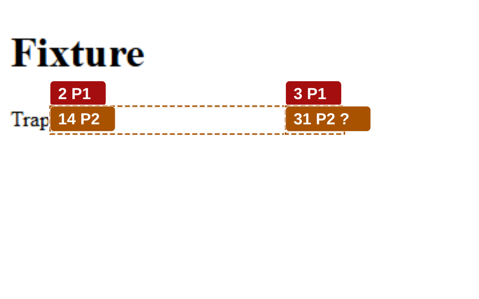

### P1 fixture pages: accessibility run

**FAILED**: 24 failed, 27 need review, 51 passed. Highest severity of failures: P1.

| # | Severity | Finding |
|---|---|---|
| 1 | P1 | Clickable element cannot be reached with the Tab key |
| 2 | P1 | Keyboard focus is trapped on this element |
| 3 | P1 | Keyboard focus is trapped on this element |
| 4 | P1 | Link has no accessible name |
| 5 | P1 | Form field has no accessible name |

[Open the full report](report.html) | [Review queue, 29 items](report.html#review) | [Traceability](report.html#trace)

Run a11y\-6b565e75558d on Chrome for Testing 156.0.8078.47 through the CDP driver, recorded 2026\-10\-26. revisum\-report/0.1.0.
