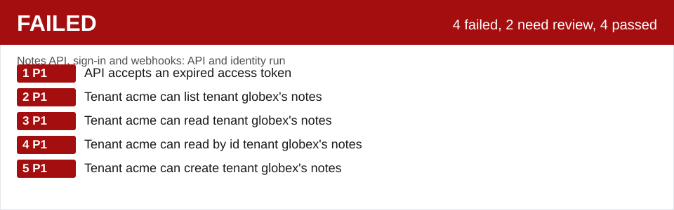

### Notes API, sign\-in and webhooks: API and identity run

**FAILED**: 4 failed, 2 need review, 4 passed. Highest severity of failures: P1.

| # | Severity | Finding |
|---|---|---|
| 1 | P1 | API accepts an expired access token |
| 2 | P1 | Tenant acme can list tenant globex's notes |
| 3 | P1 | Tenant acme can read tenant globex's notes |
| 4 | P1 | Tenant acme can read by id tenant globex's notes |
| 5 | P1 | Tenant acme can create tenant globex's notes |

[Open the full report](report.html) | [Review queue, 4 items](report.html#review) | [Traceability](report.html#trace)

Run api\-6e6f2d4261f9 on local mock services, virtual clock, recorded 2026\-10\-26. revisum\-report/0.1.0.
