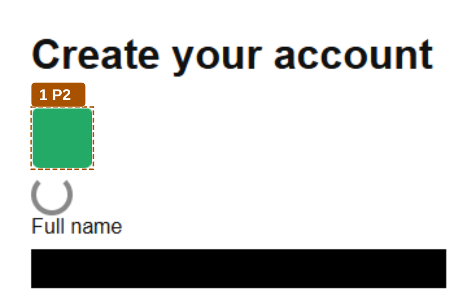

### Sign\-up flow: functional run on the sign\-up fixture app

**FAILED**: 2 failed, 0 need review, 4 passed. Highest severity of failures: P2.

| # | Severity | Finding |
|---|---|---|
| 1 | P2 | Logo image has no text alternative |
| 2 | P3 | No field labelled "Email address"; the page labels it "Email" |

[Open the full report](report.html) | [Review queue, 0 items](report.html#review) | [Traceability](report.html#trace)

Run app\-d5c07435d314 on cdp\-chromium \(CDP driver\), recorded 2026\-01\-15T10:30:00.000Z. revisum\-report/0.1.0.
